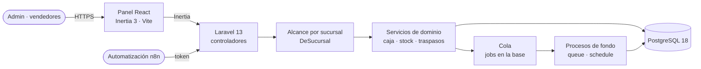
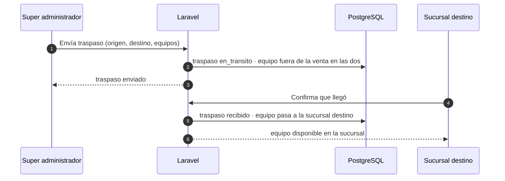
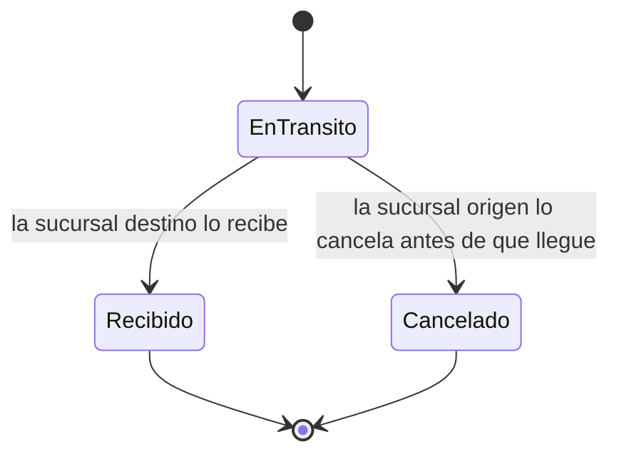
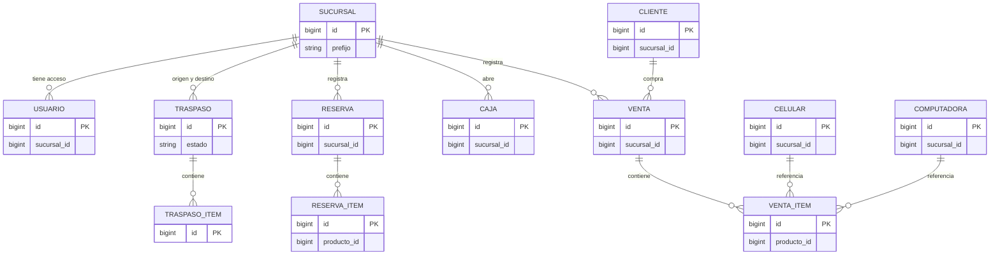

<div align="center">

<br/>

**Sistema interno para una tienda de tecnología: inventario, ventas, reservas, servicio técnico y reportes, con varias sucursales.**


<br/>


</div>


##  Contenido

- [El problema](#-el-problema)
- [La solución](#-la-solución)
- [Funcionalidades](#-funcionalidades)
- [Arquitectura](#-arquitectura)
- [Flujos de trabajo](#-flujos-de-trabajo)
- [Modelo de datos](#-modelo-de-datos)
- [Criterios y decisiones](#-criterios-y-decisiones)
- [Stack](#-stack)
- [Estructura del repo](#-estructura-del-repo)
- [Puesta en marcha](#-puesta-en-marcha)
- [Pruebas y calidad](#-pruebas-y-calidad)
- [Despliegue](#-despliegue)
- [Estado y pendientes](#-estado-y-pendientes)
- [Licencia y autoría](#-licencia-y-autoría)


##  El problema

Una tienda de celulares y computadoras con más de una sucursal necesita saber, a la vez, qué equipo tiene cada una, quién lo vendió, cuánto cuesta y dónde está. Con planillas separadas por sucursal, un mismo equipo podía venderse dos veces, un traspaso quedaba sin registrar y la caja del día no cuadraba con las boletas. El servicio técnico y los accesorios sumaban otra planilla.

##  La solución

**Blackphone** —la empresa de celulares y servicio técnico de **Axel**— opera con este sistema **privado**: no tiene tienda pública ni pantallas abiertas a internet. Todo lo que está detrás de `/` pide sesión. Concentra el inventario, las ventas, las reservas con anticipo, el servicio técnico, las cotizaciones, los egresos, los clientes y los reportes de todas las sucursales, con un panel para administración y otro para vendedores.

| Rol | Qué hace |
|---|---|
| **Super administrador** | Ve todas las sucursales o una a la vez. Crea sucursales, cuentas y roles. |
| **Administrador de sucursal** | Trabaja solo con su sucursal y puede dar acceso a ella, sin crear cuentas fuera de su alcance. |
| **Vendedor** | Vende, reserva, recibe equipos de servicio técnico y cotiza desde su propio panel. |


##  Funcionalidades

| Módulo | Qué resuelve |
|---|---|
| **Resumen** | Cómo va el día y el mes, avisos y reportes automáticos. |
| **Ventas** | Registro con varios ítems, permuta, pago con tarjeta y boleta en A4 y 80 mm. |
| **Reservas** | Separar un producto con anticipo, comprobante y control de vencimiento. |
| **Servicio técnico** | Ingreso, costo, estado del equipo y recibo para el cliente. |
| **Cotizaciones** | Armado, PDF, envío por correo y por WhatsApp, individual o en lote. |
| **Egresos** | Gastos del negocio con exportación en PDF. |
| **Clientes** | Ficha, historial de compras y actividad. |
| **Inventario** | Celulares, computadoras, equipos de marca y accesorios, con condición Nuevo o Seminuevo, IMEI y número de serie. |
| **Traspasos** | Mover equipos entre sucursales; el equipo sale de la venta en origen y destino hasta que se recibe o se cancela. |
| **Caja diaria** | Apertura, movimientos y cierre de caja por sucursal. |
| **Auditoría** | Conteo físico contra el sistema, resolución de diferencias y PDF. |
| **Reportes** | Ventas, ganancias y cierres por día, semana, mes y año. |
| **Exportaciones** | PDF de inventario por tipo, por nombre o con un filtro armado a mano. |
| **Usuarios y roles** | Roles con permisos por módulo. El vendedor tiene su propio panel. |
| **Sucursales** | Cada una con su inventario, ventas, reservas, servicios, clientes y egresos, y con sus códigos de nota (`CBA-V001`, `SUC-V001`). |
| **Datos del negocio** | Nombre, NIT, contacto y dirección que salen impresos en cada comprobante. |


##  Arquitectura

<p align="center">
  
</p>

Un solo despliegue de Laravel (una imagen) con el panel React montado por Inertia. El **alcance por sucursal** se aplica en los modelos, no en cada pantalla: un registro sin sucursal se guarda en la sucursal activa de quien lo carga, y las consultas se filtran por `sucursal_id`.




##  Flujos de trabajo

### Traspaso de un equipo entre sucursales

Envía solo el super administrador, que es el único que ve las dos sucursales. Confirma la llegada la sucursal destino. Mientras el equipo viaja, queda fuera de la venta en las dos sucursales.



### Estados de un traspaso




##  Modelo de datos

Las entidades que dependen de una sucursal llevan `sucursal_id`; los traspasos guardan sucursal de origen y de destino.




##  Criterios y decisiones

| Decisión | Por qué |
|---|---|
| **Aislamiento por sucursal en el modelo** | Un alcance global (`App\Models\Concerns\DeSucursal`) filtra todas las consultas. Ninguna pantalla tiene que acordarse de filtrar, y no hay forma de mirar otra sucursal escribiendo la dirección a mano. |
| **Nadie reparte más alcance del que tiene** | Un administrador de sucursal no crea super administradores ni cuentas fuera de su sucursal. |
| **El sistema no se queda sin administradores** | No permite quitar el último super administrador ni apagar la última sucursal encendida. |
| **Diseño centralizado** | Color, tipografía, radios, sombras y tiempos viven en `src/resources/css/tokens.css`. Cambiar ahí cambia toda la interfaz. |
| **Todo en Docker** | Un solo `docker compose up` levanta la aplicación, la base, la cola, el programador y el frontend. |
| **Vendedor con horario** | Solo inicia sesión dentro del horario de `src/config/horario.php`. |
| **Contraseñas** | Mínimo 8 caracteres con mayúscula, minúscula, número y símbolo. En producción se verifica además que no estén en listas de filtraciones. |
| **Seguridad en producción** | Con `APP_ENV=production` se fuerzan HTTPS, HSTS y una CSP estricta. Ningún secreto se escribe en el código: todo sale de `.env`. |


##  Stack

| Capa | Tecnología | Versión |
|---|---|---|
| Backend | Laravel · PHP | 13 · 8.5 en la imagen Docker (`composer.json` admite desde 8.3) |
| Autenticación y API | Sanctum · Ziggy | 4 · 2 |
| Frontend | React · Inertia · Vite | 19.3 · 3.7 · 8.3 |
| Estilos | Tailwind CSS · sistema de tokens propio | 3.x en `package.json` |
| PDF | Dompdf (`barryvdh/laravel-dompdf`) | 3.1 |
| Datos | PostgreSQL | 18 |
| Integraciones | Google Drive (Flysystem) · n8n | n8n con token de automatización |
| Contenedores | Docker Compose | `app`, `db`, `queue`, `scheduler`, `node`, `adminer` |


##  Estructura del repo

```text
.
├── Dockerfile · Dockerfile.production     imágenes de desarrollo y producción
├── docker-compose.yml                     entorno local (app 8030 · db 5440 · node 5180)
├── docker-compose.production.yml          despliegue en VPS
├── DESPLIEGUE.md                          guía de publicación del dominio
├── docker/                                configuración de servicios
└── src/                                   aplicación Laravel
    ├── app/Models/                        entidades (incluye Concerns/DeSucursal)
    ├── app/Http/Controllers/              controladores de cada módulo
    ├── config/horario.php                 horario de ingreso del vendedor
    ├── database/migrations/               esquema (traspasos, sucursales, caja, piezas…)
    ├── resources/css/tokens.css           identidad visual
    ├── resources/js/                      panel React (Inertia)
    ├── routes/                            web, auth, api y automatización
    └── tests/                             pruebas Feature y Unit
```


##  Puesta en marcha

Hace falta Docker.

```bash
cp .env.example .env                 # completar POSTGRES_PASSWORD
docker compose up -d --build
cp src/.env.example src/.env
docker compose exec app php artisan key:generate
docker compose exec app php artisan migrate
```

La aplicación queda en `http://127.0.0.1:8030`.

**Primer administrador.** `UserSeeder` lo crea con `SEED_ADMIN_NAME`, `SEED_ADMIN_EMAIL` y `SEED_ADMIN_PASSWORD` (en `src/.env`, sin valores en el repositorio). El seeder nunca cambia la contraseña de una cuenta existente. Los demás usuarios se crean desde **Usuarios y roles**.

```bash
docker compose exec app php artisan db:seed
docker compose --profile herramientas up -d    # opcional: Adminer en 8031
```

Para trabajar el frontend, con `FRONTEND_MODE=dev` en `.env` el contenedor `node` levanta Vite con recarga en caliente. Con `build` (por defecto) compila una vez.


##  Pruebas y calidad

```bash
docker compose exec app php artisan test
```

Hay pruebas `Feature` y `Unit` en `src/tests/`. No se corrieron para este README.


##  Despliegue

El despliegue en el VPS está documentado en [`DESPLIEGUE.md`](DESPLIEGUE.md): DNS en Cloudflare, primera instalación, publicación del dominio, actualizaciones, qué no se toca y cómo recuperarse si algo falla. Blackphone corre con su propio dominio, base, claves y volúmenes, separado de otros sitios en el mismo servidor. Cuelga del proxy existente con un bloque propio. Los detalles de servidor no se publican en este repositorio.


##  Estado y pendientes

- Historial de cambios: `git log`.
- Estado de producción: **no verificado** desde este README. La guía de despliegue describe el paso de demo a producción, con la base limpia como paso previo.
- Documentos internos de arquitectura y revisiones en `cerebro/` (fuera del repositorio).


##  Licencia y autoría

Sistema privado. El repositorio no incluye archivo de licencia; no se distribuye sin autorización.

**Blackphone** es la empresa del cliente **Axel**, para quien se desarrolló este sistema a medida. El desarrollo es de **Ing. Santiago Abasto**.
